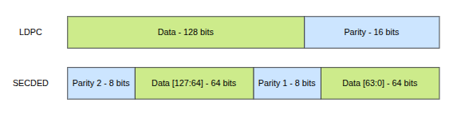
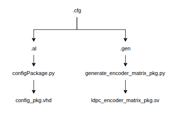

# LDPC ECC

LDPC-based error correction for the POLARA L2 cache using an LDPC(144,128) code. Each 128-bit L2 data word is protected by 16 parity bits while preserving the existing 144-bit data-array width.

### Components

- **[Encoder](encoder/README.md):** generates a 144-bit codeword on both L2 write paths
- **[Decoder](decoder/README.md):** restores the 128-bit data word on the L2 read path and supports ready/valid backpressure


## Codeword Format

The baseline implementation stores two independent 64-bit SECDED blocks. The LDPC implementation instead protects the complete 128-bit data word with a single codeword.



## LDPC Configuration

The [`matrices`](matrices/) directory contains the `.cfg`, `.gen` and `.al` files describing the selected LDPC code.



The `.gen` generator matrix is converted into a SystemVerilog parity-matrix package for the combinational encoder. The same `.cfg` configuration is used to generate the decoder, ensuring that both components implement the same LDPC(144,128) code.

A valid 144-bit codeword `c` must satisfy the parity checks defined by matrix `H`:

```text
H × cᵀ = 0
```