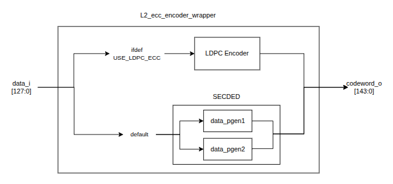

# LDPC Encoder

The encoder converts each 128-bit L2 data word into a 144-bit LDPC codeword.

## Encoder Wrapper

`L2_ecc_encoder_wrapper` selects the ECC implementation according to the `USE_LDPC_ECC` compilation macro.

When `USE_LDPC_ECC` is enabled, the wrapper uses the combinational `ldpc_encoder` module. Otherwise, it uses the original SECDED implementation.

## LDPC Encoder

`ldpc_encoder` computes the 16 parity bits defined by the generated LDPC matrix and appends them to the 128-bit input data.

The implementation is fully combinational and does not add a pipeline cycle to the L2 write path.
