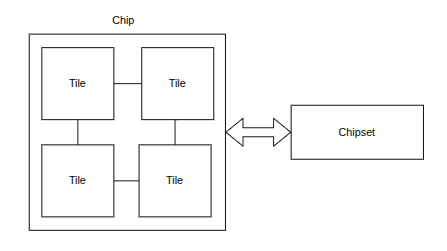
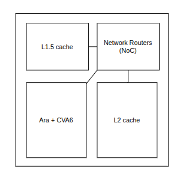
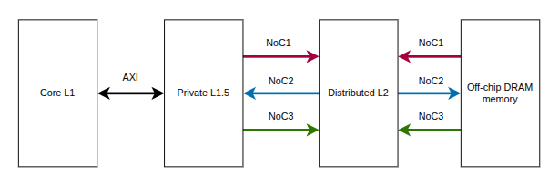
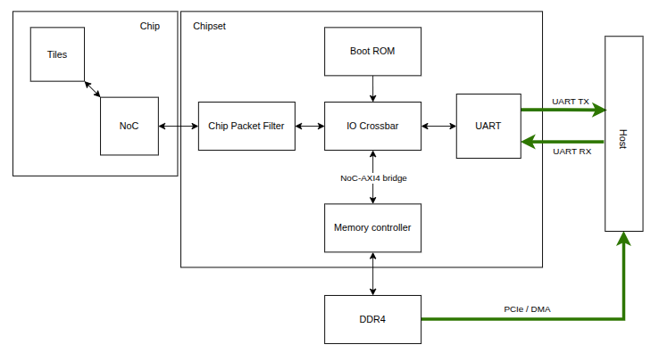

# POLARA Architecture

This page provides a simplified architectural overview of the POLARA system and the components relevant to the L2 cache ECC integration.

## Simplified OpenPiton Architecture

The POLARA FPGA system consists of a 2×2 multicore chip connected to the chipset interfaces required for external memory and host communication.

## CORE-V POLARA Tile

Each tile combines a CVA6 scalar core, an Ara vector unit, private caches, a distributed L2 cache bank, and an interface to the OpenPiton network-on-chip.

## Memory Hierarchy

Memory requests pass through the private processor caches, the OpenPiton L1.5 and L2 cache levels, and finally the off-chip memory subsystem when required.

## FPGA System Block Diagram

The block diagram shows the connections between the POLARA FPGA design, external DDR4 memory, UART, and the host computer.

