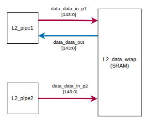
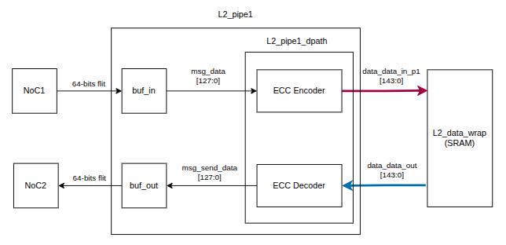
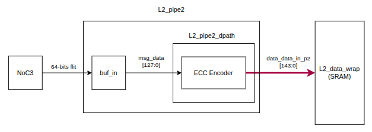
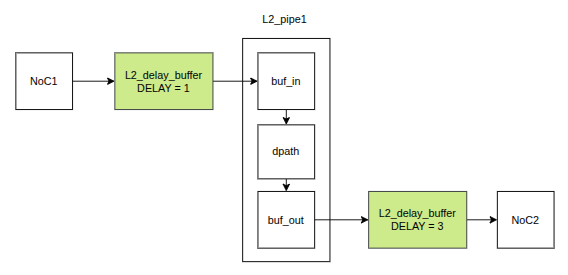
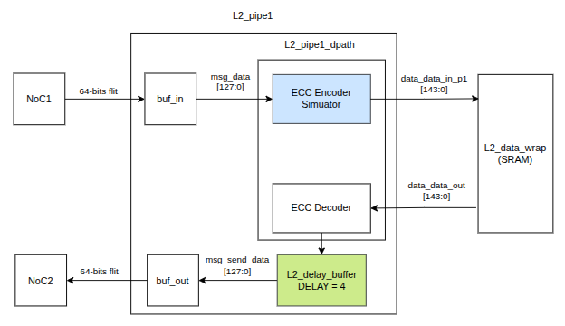

# LDPC Latency Simulation

RTL modules used to evaluate LDPC encoder and decoder latency in the POLARA L2 cache before integrating the complete LDPC implementation.

Enabled with the `SIMULATE_LDPC_LATENCY` compilation macro.

## L2 Cache Architecture

Wrapper around the L2 data SRAM, showing its main read and write interfaces:

Simplified view of the read and write data paths through the first L2 pipeline:

Simplified view of the write data path through the second L2 pipeline:

## Delay Insertion

Two latency models were evaluated.

### Noc Interface

### L2 Datapath

## RTL Components

### Encoder Simulator

[`ldpc_encoder_simulator.sv`](ldpc_encoder_simulator.sv) validates the encoder placement and preserves the original 144-bit L2 data format.

By default, the encoder is combinational. The optional `PIPELINE` parameter adds one cycle of encoder latency.

### L2 Delay Buffer

[`L2_delay_buffer.sv`](L2_delay_buffer.sv) introduces a configurable number of latency cycles while preserving the ready/valid handshake and propagating backpressure through the pipeline.

For a detailed explanation of the ready/valid handshake and backpressure propagation, see [Backpressure Handling](backpressure.md).