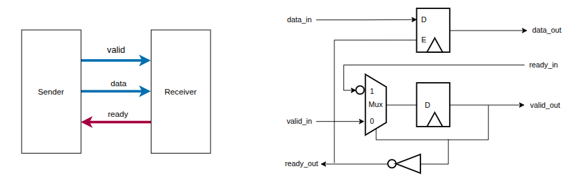
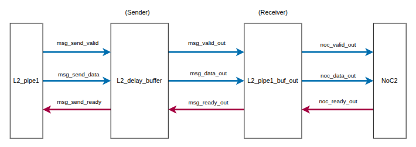

# Backpressure Handling

`L2_delay_buffer` is a generic module that adds configurable latency to a ready/valid data path while preserving flow control between a producer and a consumer.

Based on Sections 22.1.2 and 22.1.3 of:

> William J. Dally, R. Curtis Harting, and Tor M. Aamodt, *Digital Design Using VHDL: A Systems Approach*, Cambridge University Press, 2016.

## Ready/Valid Flow Control

The producer sets `valid` when data is available. The consumer sets `ready` when it can receive the data. A transfer occurs only when both signals are active.

A simple chain of registers works only if the consumer is always ready. If `ready` is low, the data and `valid` must remain unchanged until the transfer can occur.

Each delay stage must therefore pause when the next stage cannot accept new data. The `ready` signal travels backward through the stages to pause the previous modules.

This behavior is called **backpressure**. It prevents data from being lost or overwritten when the consumer is temporarily unavailable.

## L2 Pipeline Example

`L2_delay_buffer` was inserted between `l2_pipe1` and `l2_pipe1_buf_out`, which forwards responses toward NoC2.

If NoC2 cannot accept a response, the transaction is held and backpressure propagates toward `l2_pipe1`. Transfers resume when the downstream path becomes ready.

`mode_in` is delayed with the response payload to keep the control information aligned with its corresponding data.